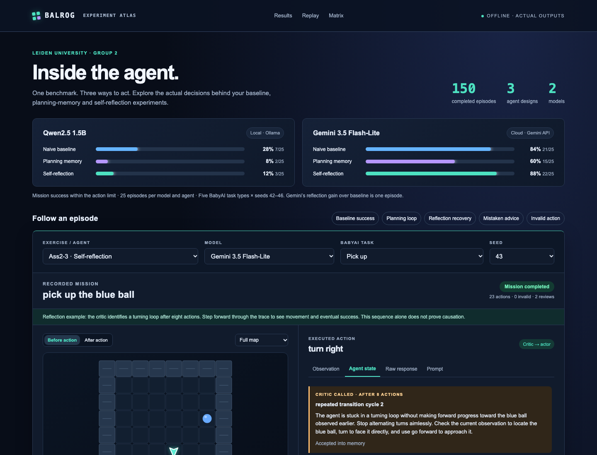
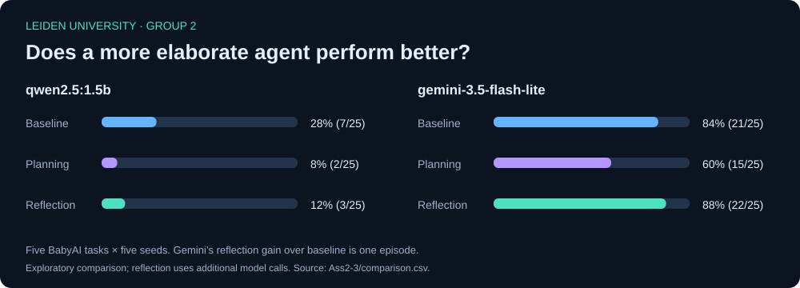

# When does self-reflection help an LLM agent?

**Leiden University · Group 2 · Agentic LLM — Assignment 2**

An experimental comparison of three agent designs on BabyAI using BALROG: a naive baseline, persistent planning and subgoal memory, and bounded actor–critic self-reflection. We evaluated a local Qwen model and a cloud-hosted Gemini model across **150 completed episodes** and **10,279 environment actions**.

The key finding: **a more elaborate agent does not automatically perform better.** Planning reduced success for both models. Reflection achieved the best observed Gemini result, but its gain over the baseline was only one episode; Qwen's baseline remained its strongest configuration.

**[Explore the live demo](https://leiden-group-2-balrog.blackknoll66.chatgpt.site)** · **[Browse the results](https://leiden-group-2-balrog.blackknoll66.chatgpt.site/results.html)** · **[Download the CSV](https://leiden-group-2-balrog.blackknoll66.chatgpt.site/comparison.csv)** · **[Setup guide](docs/SETUP.md)**

[](https://leiden-group-2-balrog.blackknoll66.chatgpt.site)

## What this project investigates

Can explicit planning or occasional self-review improve an LLM's ability to navigate, interact with objects, and complete instructions in a partially observable environment?

| Exercise | Agent design | What happens before an action |
|---|---|---|
| [Ass2-1](Ass2-1/README.md) | Naive baseline | The model receives the mission, text observation and recent history, then returns one action. |
| [Ass2-2](Ass2-2/README.md) | Planning memory | One call returns `PLAN`, `SUBGOAL` and `ACTION`. Valid plan/subgoal updates persist into the next prompt. |
| [Ass2-3](Ass2-3/README.md) | Bounded self-reflection | A separate critic call reviews recent behavior when triggered. Accepted advice is passed to the actor before its next action. |

All agents use text observations. The board in the demo is reconstructed for presentation; it was not an image input available to the models. Memory resets between episodes. There is no fine-tuning or weight update.

## Results

**Metric:** percentage of episodes in which the full mission was completed within the action limit. A complete evaluation can contain unsuccessful missions.

| Model | Hosting | Baseline | Planning memory | Self-reflection |
|---|---|---:|---:|---:|
| Qwen2.5 1.5B | Local, via Ollama | **28% (7/25)** | 8% (2/25) | 12% (3/25) |
| Gemini 3.5 Flash-Lite | Cloud, via Gemini API | 84% (21/25) | 60% (15/25) | **88% (22/25)** |

Model labels are the identifiers recorded in the experiment manifests: `qwen2.5:1.5b` and `gemini-3.5-flash-lite`. Check your provider's available models before starting a new cloud run.



### Performance by BabyAI task

Each task cell represents **five episodes**, one for each environment seed 42–46.

| Model / agent | Go to | Pick up | Open | Put next | Pick up → go to |
|---|---:|---:|---:|---:|---:|
| Qwen · Baseline | 80% | 20% | 20% | 0% | 20% |
| Qwen · Planning | 20% | 20% | 0% | 0% | 0% |
| Qwen · Reflection | 40% | 0% | 0% | 0% | 20% |
| Gemini · Baseline | 100% | 80% | 100% | 60% | 80% |
| Gemini · Planning | 80% | 80% | 40% | 40% | 60% |
| Gemini · Reflection | 100% | 100% | 100% | 40% | 100% |

Source: [`Ass2-3/comparison.csv`](Ass2-3/comparison.csv). The root [`comparison.csv`](comparison.csv) is the same table for the website. `ALL` rows aggregate task rows; they are not additional episodes.

### What we learned

- **Planning can introduce new failure modes.** Qwen's planning run produced 549 invalid action candidates across 2,483 actions; Gemini's produced 64 across 1,409. The treatment changes the prompt, memory and parser together, so this does not isolate the effect of planning alone.
- **Reflection helped selectively.** Gemini improved from 21 to 22 successful episodes: **+4 percentage points** overall. Pickup and sequential pickup/navigation improved, while `putnext` fell from 3/5 to 2/5.
- **Reflection has a cost and can be wrong.** Gemini made 31 critic calls, all structurally accepted; Qwen made 91, with 26 accepted. Acceptance checks response format and length, not whether the advice is correct.
- **Reliable execution matters alongside reasoning.** Useful advice must translate into valid actions that change the environment. Persistent loops, invalid outputs and mistaken advice can undermine an otherwise plausible plan.

These are exploratory results, not evidence of a statistically established improvement. There are only five seeds per task, no repeated model samples for each fixed instance, and earlier results informed the later agent designs. Baselines were collected in earlier runs, reflection uses extra computation, and output-token budgets differ between models. This covers five task types in **one benchmark family**, not the complete BALROG benchmark suite.

## How reflection works

The actor and critic use the same model in separate calls. The critic reviews the mission, previous advice and the last eight observed transitions.

```text
Observe the environment
        ↓
Review due? ── yes → critic reviews recent behavior → validate and save advice
        ↓                                                   ↓
Actor chooses one action using the observation, history and saved advice
        ↓
Validate action → execute → record transition → repeat
```

A review is triggered by four unchanged observations, a repeated transition cycle of length 2–4, or a scheduled interval of 16 actions. Reviews have an **8-action cooldown** and a **4-review cap per episode**. Advice is limited to 60 words; empty, overlong, truncated and bare-action responses are rejected. This is a custom bounded reflection approach, not a reproduction of ReAct or Reflexion.

Implementation: [`Ass2-3/agent/reflection.py`](Ass2-3/agent/reflection.py).

## Get started

**To explore the results:** open the [live demo](https://leiden-group-2-balrog.blackknoll66.chatgpt.site), or clone this repository and open `index.html` in a modern browser. The replay data is embedded, so viewing it makes no model calls. `results.html` displays the CSV with filters.

**To run experiments:** follow the [setup guide](docs/SETUP.md) to create the Python environment, install the pinned BALROG revision and configure Ollama or Gemini. From the repository root, after setup:

```bash
# Full local evaluations: five tasks × five seeds per command.
python Ass2-1/run_local.py --provider ollama --profile baseline --seeds 42 43 44 45 46
python Ass2-2/run_exercise2.py --provider ollama --agent custom --profile baseline --seeds 42 43 44 45 46
python Ass2-3/run_exercise3.py --provider ollama --agent reflection --profile baseline --seeds 42 43 44 45 46
```

The setup guide includes the required planning-agent installation, cloud commands, quota handling and resume instructions. `baseline` selects the evaluation profile; it does not select the agent. Omitting the profile uses a short diagnostic configuration.

**To recompute the published comparison without an API key:**

```bash
python scripts/summarize_results.py
```

This reads the six selected runs, verifies the checked-in comparison against the completed episode records, and writes `generated/comparison.csv`.

## Repository guide

| Path | Contents |
|---|---|
| [`Ass2-1/`](Ass2-1/) | Baseline runner, Gemini adapter, tests and recorded baseline runs. |
| [`Ass2-2/`](Ass2-2/) | Planning agent, runner, validation tests and recorded planning runs. |
| [`Ass2-3/`](Ass2-3/) | Reflection agent, runner, comparison tools, tests and recorded reflection runs. |
| [`Ass2-3/experiments.json`](Ass2-3/experiments.json) | The six run directories used in the published comparison. |
| [`run_viewer/`](run_viewer/) | Viewer source, reconstruction builder and validation records. |
| [`index.html`](index.html), [`results.html`](results.html) | Ready-to-open static viewer and CSV results page. |
| [`docs/SETUP.md`](docs/SETUP.md) | Installation, evaluation, testing and viewer-rebuild instructions. |

Within each run, start with `matrix.csv` and `episodes.csv`, then inspect the trajectory CSVs and `prompts.jsonl`. Prompts record the model's input before an action; trajectory observations record the environment after it. `decisions.jsonl` and `reflections.jsonl`, where present, expose memory updates, action parsing and critic feedback. The CSV candidate may differ from the executed action because invalid candidates trigger BALROG's `go forward` fallback. Structured decision records are harness logs, not hidden model reasoning.

Only the six main run directories are included. Their raw logs can contain interrupted attempts; the comparison and viewer select completed episodes. No new cloud evaluations were needed to prepare this repository.

## Acknowledgements

Course project by **Leiden University, Group 2**, built on [BALROG](https://github.com/balrog-ai/BALROG) and its BabyAI/MiniGrid environment integration. BALROG revision used: `b7afe79e3e4265811cfa985ed7c95c4d1a11e3f5`.

The experiment harnesses, agent variants, analysis and replay viewer are the coursework contributions. Upstream reference code and saved BALROG code snapshots retain their original attribution; see [third-party notices](docs/THIRD_PARTY_NOTICES.md).
